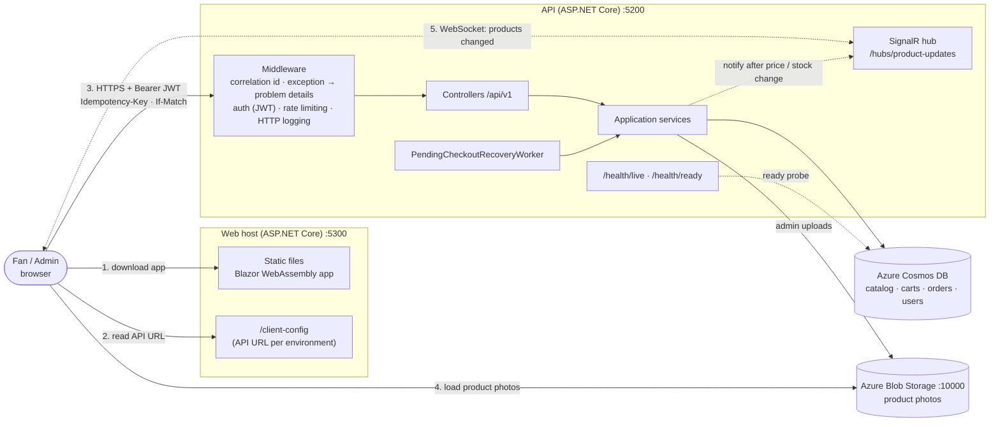
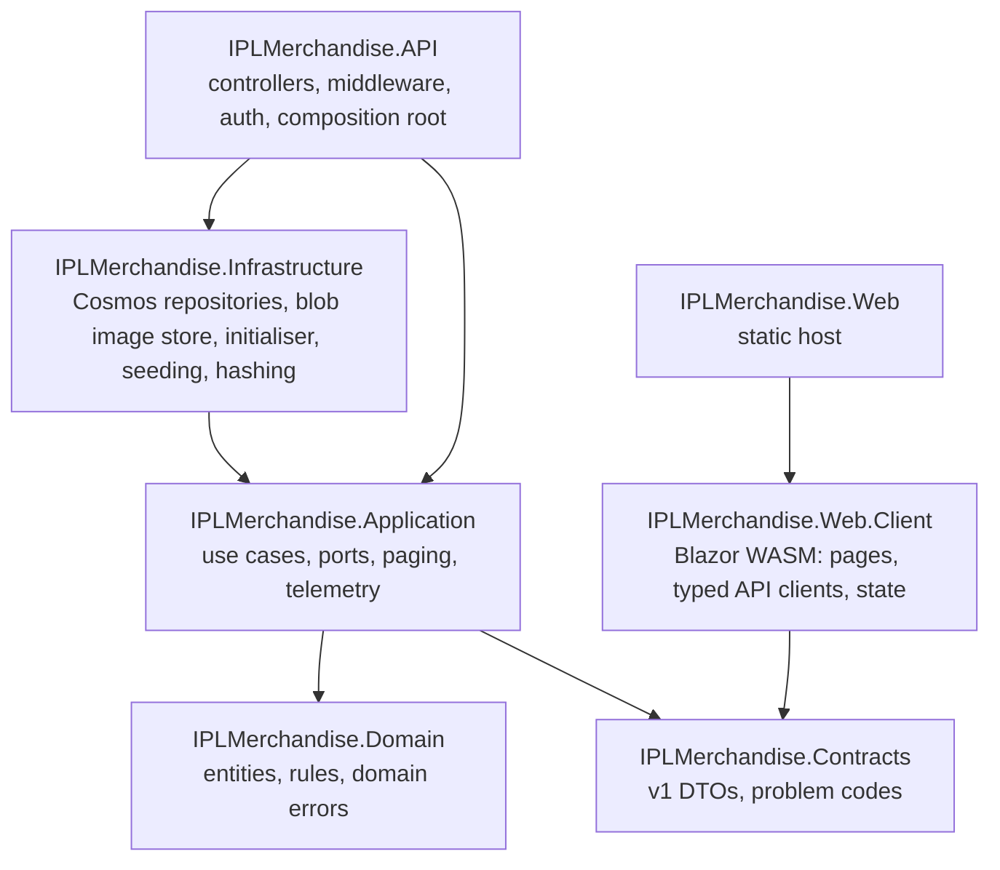
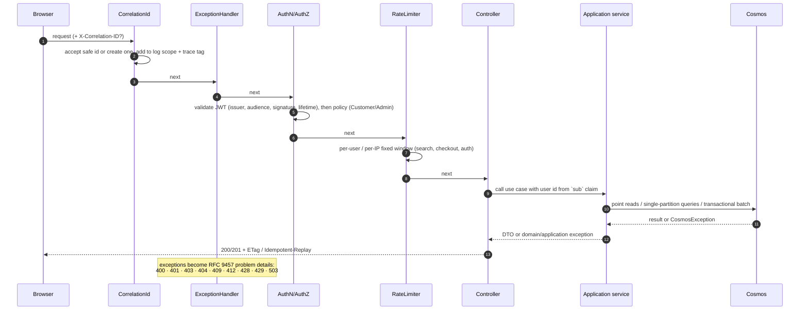
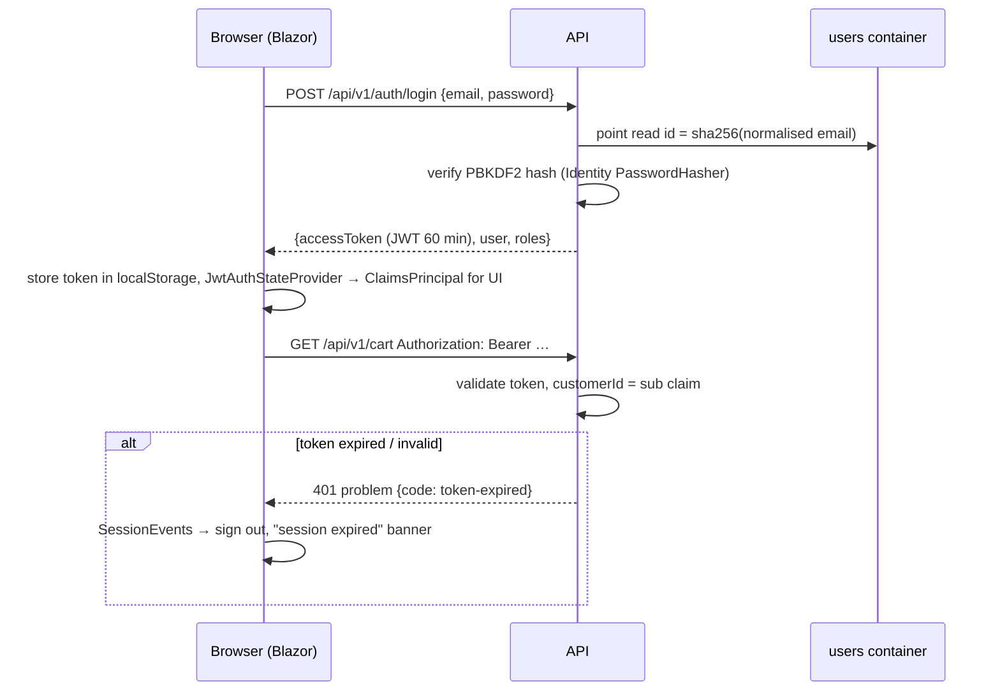
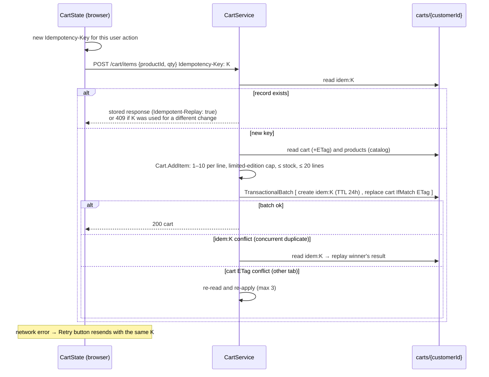
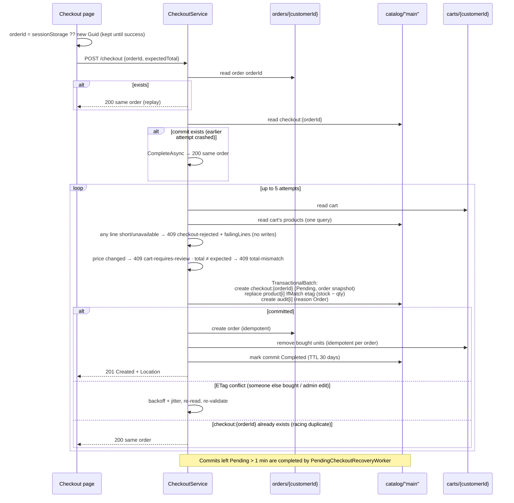
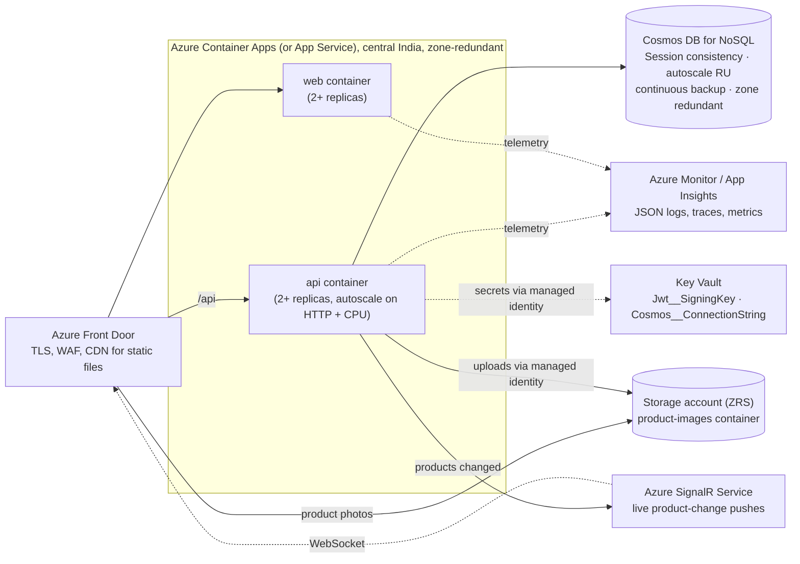
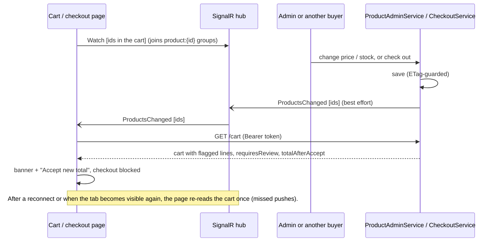
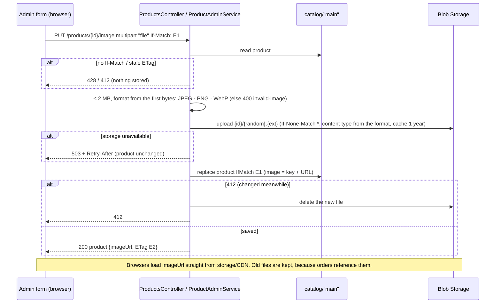

# Architecture

Diagrams use Mermaid (rendered by GitHub and most IDEs). The reasoning behind each choice is in [DESIGN.md](DESIGN.md).

## 1. System context and runtime



The browser talks to the API directly (CORS allow-list) and loads product photos straight from storage. The web host never sees tokens and holds no business logic. Locally, Blob Storage is Azurite.

## 2. Project dependencies



Arrows point inwards: Domain depends on nothing; Infrastructure implements interfaces declared in Application. The client shares only `Contracts` with the server.

Test projects: `UnitTests` → domain rules only (no infrastructure); `IntegrationTests` → the whole API via `WebApplicationFactory` against the Cosmos emulator; `Web.Tests` → client components with bUnit and fake API clients.

## 3. Request pipeline (API)



## 4. Authentication flow



## 5. Cart update flow (idempotent)



## 6. Checkout flow



## 7. Concurrency handling at a glance

| Conflict | Mechanism | Outcome |
|---|---|---|
| Two buyers, last unit | Batch with `IfMatchEtag` per product | One commits; the other retries, sees 0 stock → 409 with failing line |
| Buyer vs admin stock/price edit | Same ETag on the product | Whichever writes second retries (buyer) or gets 412 (admin) |
| Two admins | `If-Match` required (428 if missing) | Second gets 412 + current ETag; UI offers reload |
| Same cart, two tabs | Cart ETag | Re-read and re-apply (bounded) |
| Double-click / retry, cart | Idempotency record created in the same batch | Applied once; duplicates replay |
| Double-click / retry, checkout | Order id = commit record id, created in the stock batch | One order, one deduction |

## 8. Stored documents

```jsonc
// catalog  (pk /storeId)
{ "id": "csk-cap", "storeId": "main", "docType": "product", "name": "CSK Cap", "searchName": "csk cap",
  "type": "Cap", "franchiseCode": "CSK", "description": "…", "price": 499.00, "stockQuantity": 97,
  "isActive": true, "createdAtUtc": "2026-01-01T00:01:00.0000000Z", "updatedAtUtc": "…", "_etag": "\"…\"",
  // only when a photo was uploaded; the file itself is in Blob Storage
  "image": { "key": "csk-cap/3f9c….jpg", "url": "https://<storage or CDN>/product-images/csk-cap/3f9c….jpg", "contentType": "image/jpeg" } }

{ "id": "audit:4f0c…", "storeId": "main", "docType": "audit", "productId": "csk-cap", "field": "Stock",
  "oldValue": 100, "newValue": 97, "changedBy": "customer:9b1e…", "changedAtUtc": "…",
  "reason": "Order", "note": "Order 2f6a…", "orderId": "2f6a…" }

{ "id": "checkout:2f6a…", "storeId": "main", "docType": "checkout", "customerId": "9b1e…",
  "status": "Completed", "createdAtUtc": "…", "ttl": 2592000, "order": { /* full order snapshot */ } }

// carts  (pk /customerId)
{ "id": "cart", "customerId": "9b1e…", "docType": "cart", "updatedAtUtc": "…", "appliedOrderIds": ["2f6a…"],
  "lines": [ { "productId": "csk-cap", "productName": "CSK Cap", "franchiseCode": "CSK",
               "unitPrice": 499.00, "quantity": 3, "addedAtUtc": "…" } ] }

{ "id": "idem:5c2d…", "customerId": "9b1e…", "docType": "idempotency", "requestHash": "…",
  "response": "{…cart json…}", "createdAtUtc": "…", "ttl": 86400 }

// orders  (pk /customerId)
{ "id": "2f6a…", "customerId": "9b1e…", "docType": "order", "createdAtUtc": "…", "status": "Confirmed",
  "itemCount": 6, "subtotal": 10494.00, "shippingFee": 0, "total": 10494.00,
  "lines": [ { "productId": "csk-cap", "productName": "CSK Cap", "franchiseCode": "CSK",
               "unitPrice": 499.00, "quantity": 3, "lineTotal": 1497.00, "type": "Cap",
               "imageUrl": "https://…/csk-cap/3f9c….jpg" /* photo at the time of purchase, if any */ } ] }

// users  (pk /id)
{ "id": "<sha256 of normalised email>", "docType": "user", "userId": "9b1e…", "email": "asha@example.com",
  "normalizedEmail": "ASHA@EXAMPLE.COM", "displayName": "Asha", "passwordHash": "AQAAAAIAAYag…",
  "roles": ["Customer"], "createdAtUtc": "…" }
```

## 9. Deployment architecture (recommended production)



- Containers run as the non-root `app` user; liveness `/health/live`, readiness `/health/ready`.
- Production config: `ASPNETCORE_ENVIRONMENT=Production`, `Cosmos__InitializeOnStartup=false` (schema created by `scripts/provision-cosmos.sh`), `Cosmos__UseGatewayMode=false` (Direct mode), CORS origin = the public web URL, Swagger off.
- Same image is promoted through environments; only configuration differs.
- Photos: `ImageStorage__CreateContainerIfMissing=false` (container provisioned up front), `ImageStorage__PublicBaseUrl` = the Front Door/CDN URL for the container, and a lifecycle rule for files that nothing references any more.

## 10. Live price and stock changes in open carts



## 11. Product photo upload


